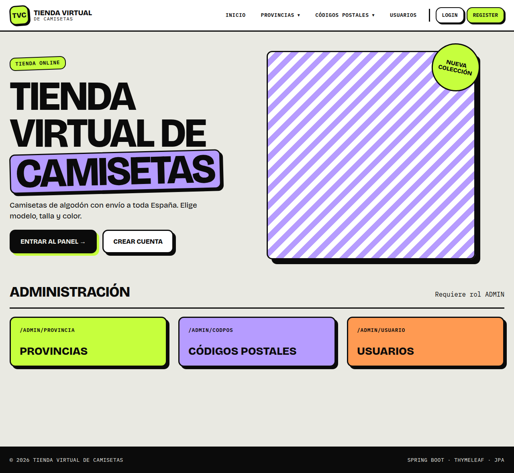
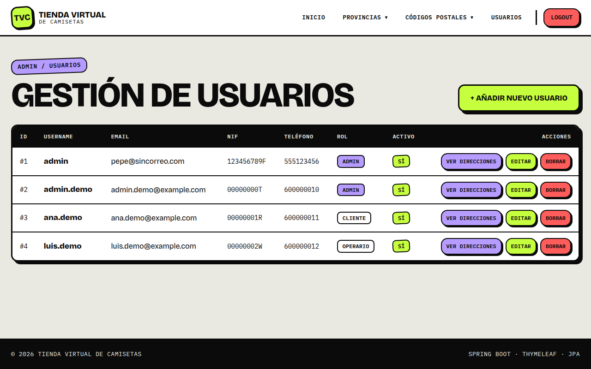
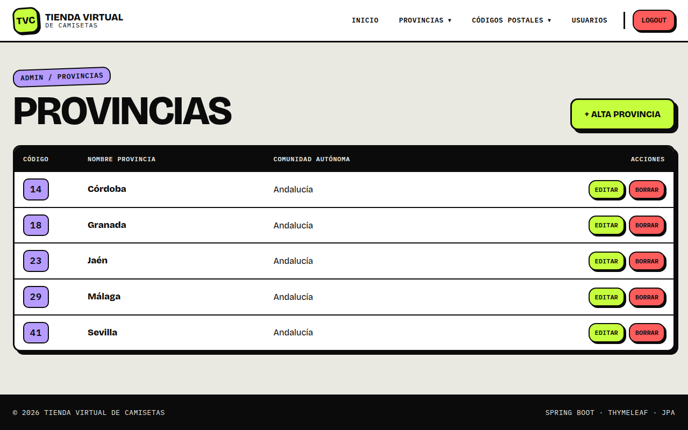
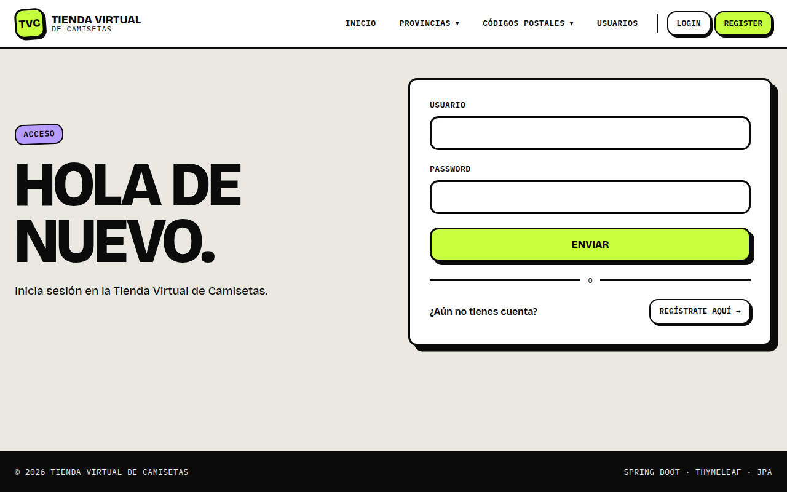
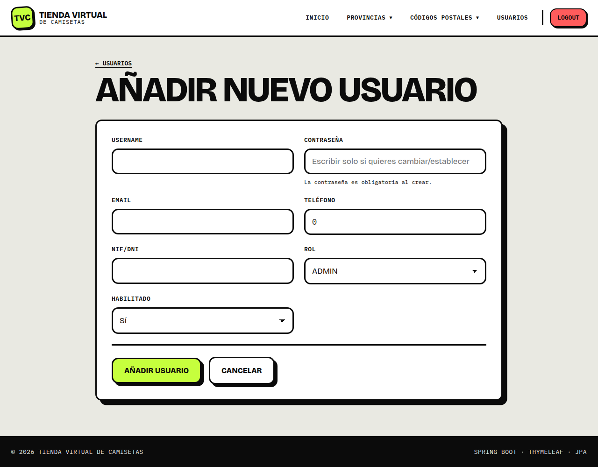
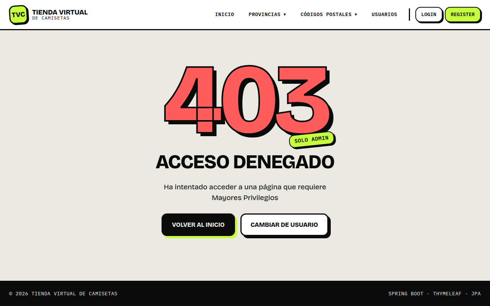
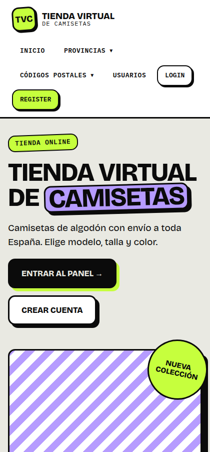

# NeoCamisetas

Tienda de camisetas con Spring Boot, Spring Data JPA, Spring Security, Thymeleaf y MySQL. Es un proyecto de ejemplo: **el pago es simulado y no se cobra nada**.

## Qué incluye

- **Catálogo público:** filtros por talla y color, y ficha de cada camiseta.
- **Carrito:** se guarda en la sesión y se conserva al iniciar sesión.
- **Pedidos:** al confirmar se comprueba y descuenta el stock en una sola transacción, con bloqueo de fila. Si falta stock de una línea, no se guarda nada.
- **Mis pedidos:** cada cliente ve solo los suyos.
- **Administración:** camisetas, pedidos y sus estados, usuarios, provincias y códigos postales. Cancelar un pedido devuelve el stock.
- **Seguridad:** contraseñas con BCrypt, roles y protección CSRF.

## Demo

Puedes probarla sin instalar nada en [`neocamisetas.nonit0.dev`](https://neocamisetas.nonit0.dev). Es una recreación estática que guarda los cambios en tu navegador; este repo contiene el proyecto real con Spring Boot y MySQL.

## Puesta en marcha

Requiere Java 21 y Docker.

```bash
cp src/main/resources/stack-spring-camiseta/.env.example src/main/resources/stack-spring-camiseta/.env
# Elige una contraseña en ese .env
docker compose --project-directory src/main/resources/stack-spring-camiseta -f src/main/resources/stack-spring-camiseta/docker-compose.yml up -d
./mvnw spring-boot:run
```

La web queda en `http://localhost:8080`. La base de datos se recrea en cada arranque con los datos de `import.sql`.

| Usuario local | Contraseña | Rol |
| :--- | :--- | :--- |
| `admin.demo` | `demo1234` | Administrador |
| `ana.demo` | `demo1234` | Cliente |
| `luis.demo` | `demo1234` | Cliente |

Son cuentas solo para desarrollo. No uses estos datos en un despliegue real.

## Pruebas

```bash
./mvnw test
```

Usan H2 en memoria, así que no necesitan Docker.

## Rutas de la tienda

| Verbo | Ruta | Acceso | Acción |
| :--- | :--- | :--- | :--- |
| `GET` | `/catalogo` | Público | Listar y filtrar camisetas |
| `GET` | `/catalogo/{id}` | Público | Ver una camiseta |
| `GET` | `/carrito` | Público | Ver el carrito |
| `POST` | `/carrito/add`, `/update`, `/remove` | Público | Modificar el carrito |
| `GET`, `POST` | `/carrito/pago` | Con sesión | Revisar y confirmar el pedido |
| `GET` | `/pedidos`, `/pedidos/{id}` | Con sesión | Ver los pedidos propios |
| `GET`, `POST` | `/admin/camiseta/**` | Admin | Gestionar camisetas |
| `GET`, `POST` | `/admin/pedido/**` | Admin | Ver pedidos y cambiar su estado |

---

## Módulos de administración

Este proyecto implementa módulos CRUD (Crear, Leer, Actualizar, Borrar) utilizando **Spring Boot**, **Spring Data JPA** (Hibernate ORM) y **Thymeleaf** para la gestión de la persistencia de las entidades clave del sistema: `Provincia`, `CodPos`, `Usuario` y `Direccion`.

## 📸 Capturas

Son anteriores a la tienda y muestran el panel de administración.



| Gestión de usuarios | Provincias |
| --- | --- |
|  |  |

| Inicio de sesión | Alta de usuario |
| --- | --- |
|  |  |

| Acceso denegado | Vista móvil |
| --- | --- |
|  |  |

## Objetivos del Proyecto

El objetivo principal es demostrar la competencia en la gestión de la persistencia de datos mediante el uso de herramientas ORM, desarrollando interfaces de administración funcionales y robustas para las entidades.

---

## 🏛️ Módulo Base: Provincia

La gestión de la entidad `Provincia` está completamente implementada y sirve como maestro para la entidad `CodPos`.

### Endpoints del CRUD de Provincia (`ProvinciaController`)
| Verbo HTTP | Ruta | Acción |
| :--- | :--- | :--- |
| `GET` | `/admin/provincia` | Listar todas las provincias. |
| `GET` | `/admin/provincia/add` | Mostrar formulario para crear una nueva provincia. |
| `POST` | `/admin/provincia/save` | Insertar la nueva provincia en la base de datos. |
| `GET` | `/admin/provincia/edit/{id}` | Mostrar formulario para editar una provincia existente. |
| `POST` | `/admin/provincia/edit/{id}` | Guardar los cambios de la edición. |
| `GET` | `/admin/provincia/del/{id}` | Mostrar formulario de confirmación de borrado. |
| `POST` | `/admin/provincia/del/{id}` | Borrar la provincia de la base de datos. |

---

## 1. Módulo CRUD: Códigos Postales (`CodPos`)

Implementación completa de la gestión administrativa de los códigos postales.

### Requisitos Funcionales
* Listado, Alta, Edición y Eliminación de códigos postales.
* **Formularios:** Incluyen campos `cp`, `municipio`, y un **desplegable de `Provincia`** para seleccionar la provincia asociada, usando su identificador interno.

### Endpoints del Módulo
| Verbo HTTP | Ruta | Acción |
| :--- | :--- | :--- |
| `GET` | `/admin/codpos` | Listar todos los códigos postales. |
| `GET` | `/admin/codpos/add` | Mostrar formulario para crear un nuevo código postal. |
| `POST` | `/admin/codpos/add` | Insertar realmente el nuevo código postal en la base de datos. |
| `GET` | `/admin/codpos/edit/{cp}` | Mostrar formulario para editar el código postal existente. |
| `POST` | `/admin/codpos/edit/{cp}` | Guardar los cambios del código postal editado. |
| `GET` | `/admin/codpos/del/{cp}` | Mostrar formulario de confirmación de borrado del código postal. |
| `POST` | `/admin/codpos/del/{cp}` | Borrar realmente el código postal de la base de datos. |

---

## 2. Módulo CRUD: Usuarios (`Usuario`)

Implementación completa de la gestión administrativa de los usuarios del sistema.

### Requisitos Funcionales
* Listado, Alta, Edición y Eliminación de usuarios.
* **Campos gestionados:** `username`, `email`, `nif`, `telefono`, `rol` (desplegable con `ENUM`), `enabled` (activo/inactivo) y `password`.

### Regla Especial: Gestión de Contraseña
* Uso de **`BCryptPasswordEncoder`**.
* **Creación:** La contraseña debe ser cifrada.
* **Edición:** Si el campo `password` llega vacío, la contraseña existente **no se modifica**. Si llega con valor, se debe cifrar con BCrypt antes de guardar.

### Endpoints del Módulo
| Verbo HTTP | Ruta | Acción |
| :--- | :--- | :--- |
| `GET` | `/admin/usuario` | Listar todos los usuarios. |
| `GET` | `/admin/usuario/add` | Mostrar formulario para crear nuevo usuario. |
| `POST` | `/admin/usuario/add` | Crear usuario (cifrando la contraseña con BCrypt). |
| `GET` | `/admin/usuario/edit/{id}` | Mostrar formulario para editar un usuario existente. |
| `POST` | `/admin/usuario/edit/{id}` | Guardar cambios de usuario (manejo condicional de `password`). |
| `GET` | `/admin/usuario/del/{id}` | Mostrar formulario de confirmación de borrado de usuario. |
| `POST` | `/admin/usuario/del/{id}` | Borrar realmente el usuario. |

---

## 3. Módulo CRUD: Direcciones (`Direccion`) - Maestro-Detalle

Implementación de la gestión de direcciones bajo el patrón **Maestro-Detalle**, donde el `Usuario` es el maestro y la `Direccion` es el detalle. Todas las rutas de dirección están anidadas bajo un usuario específico.

### Requisitos Funcionales
* Para un usuario concreto (`{idUsuario}`): Listar, Crear, Editar y Eliminar sus direcciones.
* **Formularios de Dirección:** Incluyen `tipo_via`, `nombre_via`, `numero`, y un **desplegable de `CodPos`** (mostrando CP y/o municipio).
* El `Usuario` se obtiene automáticamente del `{idUsuario}` en la ruta.
* La vista de listado de usuarios debe incluir un enlace de acceso a la gestión de direcciones.

### Endpoints del Módulo (Maestro-Detalle)
| Verbo HTTP | Ruta | Acción |
| :--- | :--- | :--- |
| `GET` | `/admin/usuario/{idUsuario}/direccion` | Listar todas las direcciones del usuario `{idUsuario}`. |
| `GET` | `/admin/usuario/{idUsuario}/direccion/add` | Mostrar formulario para crear una nueva dirección. |
| `POST` | `/admin/usuario/{idUsuario}/direccion/add` | Crear dirección asociada al usuario `{idUsuario}`. |
| `GET` | `/admin/usuario/{idUsuario}/direccion/edit/{idDireccion}` | Mostrar formulario para editar la dirección `{idDireccion}`. |
| `POST` | `/admin/usuario/{idUsuario}/direccion/edit/{idDireccion}` | Guardar cambios de la dirección `{idDireccion}`. |
| `GET` | `/admin/usuario/{idUsuario}/direccion/del/{idDireccion}` | Mostrar confirmación de borrado de la dirección `{idDireccion}`. |
| `POST` | `/admin/usuario/{idUsuario}/direccion/del/{idDireccion}` | Borrar realmente la dirección asociada al usuario `{idUsuario}`. |

---

## ⚙️ Controladores y Consideraciones Técnicas

### Controladores Base
* **`MainController`:** Gestiona las rutas principales (`/`, `/login`, `/denegado`, `/error`).
* **`ProvinciaController`:** Implementa el CRUD para la entidad `Provincia` (`/admin/provincia`).
* **`CodPosController`:** Implementa el CRUD para la entidad `CodPos` (`/admin/codpos`).
* **`UsuarioController`:** Maneja el registro (`/register`)
* **`UsuarioAdminController`:** Implementa el CRUD para la entidad `Usuario` (`/admin/usuario...`) y operaciones CRUD maestro-detalle de `Direccion` (`/admin/usuario/{idUsuario}/direccion...`).

### Implementación
* Uso de **Spring Data JPA** para los repositorios.
* Gestión correcta de las relaciones ORM.
* Utilización de **Thymeleaf** para las vistas y formularios.
* Carga de datos dinámica desde repositorios para los desplegables.
